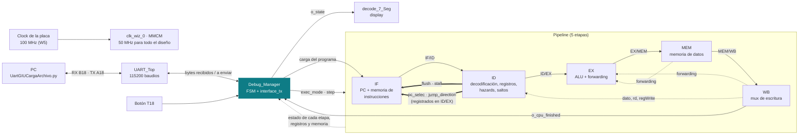

# Arquitectura general

Pipeline clásico de 5 etapas: **IF → ID → EX → MEM → WB**

Incluye **forwarding** y **detección de hazards**. 

### Archivos incluidos:
Archivo **Top-level** → `RISCV/Risc_top.v` (módulo `Risc_Top`).

## Diagrama de bloques



Las flechas gruesas son las que vuelven de ID a IF (control de saltos y stalls). Las punteadas son caminos de datos hacia atrás: escritura en el banco de registros, forwarding y el volcado hacia el Debug Manager.

🪧 acá irían las imagenes de draw.io

<!-- (formato. ) -->

## Qué instancia el top-level

`Risc_top.v` conecta, además de las cinco etapas, la infraestructura de la placa:

- `clk_wiz_0` (IP de Vivado, Clocking Wizard): del clock de 100 MHz de la placa genera el de **50 MHz** con el que corre todo el diseño. Junto con `ila_0` (analizador lógico integrado) es una de las dos IP que **no están en el repo** y se generan en Vivado.
- `UART_Top` y `debug_manager`: carga del programa y volcado de datos.
- `decode_7_Seg`: muestra el estado de la FSM del Debug Manager en el display de 7 segmentos.
- Un reset sincronizado (`r_reset_system`): se mantiene activo hasta que el Clock Wizard se bloquea y se suelta el botón de reset.

## Flujo de control entre etapas

Las señales de control no viajan sueltas: se empaquetan en buses `w_control_bits_ID` (10 bits), `w_control_bits_EX` (6 bits) y `w_control_bits_MEM` (2 bits) que se van armando de nuevo en cada frontera de etapa.

| Bus | Bits |
|---|---|
| `w_control_bits_ID` (10) | `[1:0]` ALUSrc · `[3:2]` ALUOp · `[5:4]` branch · `[6]` memRead · `[7]` memWrite · `[8]` memToReg · `[9]` regWrite |
| `w_control_bits_EX` (6) | `[1:0]` branch · `[2]` memRead · `[3]` memWrite · `[4]` memToReg · `[5]` regWrite |
| `w_control_bits_MEM` (2) | `[0]` memToReg · `[1]` regWrite |

> *Qué significa cada valor (ALUSrc, ALUOp, branch) está en `03-ID.md` (tabla de `control.v`).*

---
## Modo de ejecución: paso a paso vs. continuo

Los registros de pipeline condicionan la escritura con:

```verilog
(i_exec_mode == 1'b0 || (i_exec_mode && i_step))
```

`i_exec_mode = 0` es modo **continuo** (siempre habilitado) y `i_exec_mode = 1` es **paso a paso** (solo avanza con el pulso `i_step`).

📝 _(los `always @(posedge i_clk)` de cada etapa)_

Esto es lo que le permite al `debug_manager` congelar el pipeline entero instrucción por instrucción cuando se debuggea por UART.


## Etapas

- [02-IF.md](02-IF.md) — Instruction Fetch
- [03-ID.md](03-ID.md) — Instruction Decode
- [04-EX.md](04-EX.md) — Execute
- [05-MEM.md](05-MEM.md) — Memory Access
- [06-WB.md](06-WB.md) — Write Back
- [07-debug-uart.md](07-debug-uart.md) — Infraestructura de carga/debug por UART


## 💡 Decisiones de diseño.
### Dónde se resuelven los saltos.

A diferencia del diseño "de libro" de Patterson & Hennessy, donde los branches se resuelven en EX o MEM, acá **se resuelven en ID** (`ID/hazard_detector.v`).
 Los operandos se comparan después de pasar por un mini-forwarding propio de esa unidad.

**Ventaja:** cuando se toma un salto, solo se descarta la instrucción que IF estaba leyendo.

La penalidad es de **una burbuja**, en lugar de dos o tres si se resolviera más adelante.

**Costo:**

- **Frecuencia.** En un mismo ciclo hay que decodificar la instrucción, elegir los operandos con el forwarding local, compararlos (32 bits) y, con el `flush` resultante, volver a IF para anular la instrucción leída y elegir el próximo PC. Ese es justamente el **camino crítico** del diseño: va de la instrucción en ID al registro del próximo PC (ver `09-clock.md`). El destino del salto, en cambio, se registra en ID/EX y se aplica un ciclo después, así que no forma parte de ese camino.
- **Visibilidad y stalls.** `hazard_detector.v` necesita ver EX, MEM y WB a la vez, y hay *stalls* adicionales cuando un branch depende de un valor que todavía no está disponible.

📝 Se priorizó la menor penalidad por salto. El costo en frecuencia **es aceptable** → aun con este camino, el diseño soporta ~78 MHz, por encima de los 50 MHz actuales.

### Memoria de instrucciones direccionada por palabra

El PC no incrementa de a 4 bytes como en RISC-V real: incrementa de a **1**, porque la memoria de instrucciones tiene 32 entradas direccionadas por índice (5 bits), no por byte. 

> *Ver `08-mips-vs-riscv.md` para más contexto de por qué el diseño se aparta acá del RISC-V estándar.*