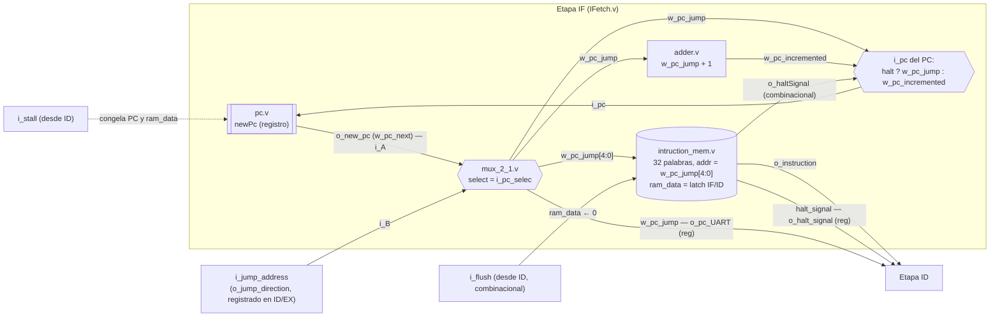

# IF → Instruction Fetch

## Resumen

Módulo que:
- Mantiene el **Program Counter** (PC), 
- lee la **instrucción actual** de la memoria de instrucciones y 
- calcula el **próximo PC** (secuencial o por salto).

## Archivos

- `IF/pc.v` → registro del PC.
- `IF/adder.v` → incrementa en 1 la dirección que se está leyendo.
- `IF/mux_2_1.v` → elige entre el PC secuencial y la dirección de salto.
- `IF/intruction_mem.v` → memoria de instrucciones (32 palabras) + carga por UART. Su registro de salida `ram_data` **es** el latch IF/ID de la instrucción.
- `IF/IFetch.v` → conecta los cuatro módulos de arriba y guarda el resto del latch IF/ID (`o_halt_signal`, `o_pc_UART`).

## Diagrama

El camino importante: el **mux** elige entre `newPc` (secuencial) y la dirección de salto, y su salida (`w_pc_jump`) hace tres cosas a la vez: 
- direcciona la memoria de instrucciones, 
- entra al sumador, y 
- vuelve al PC (como `w_pc_jump` si hay HALT, o como `w_pc_jump + 1` en el resto de los casos).

## Señales clave

| Señal | Sentido | Qué es |
|---|---|---|
| `i_jump_address` / `i_pc_selec` | entrada | dirección y selección de salto. Se calculan en **ID** (no acá) y llegan **registradas** en el latch ID/EX, o sea un ciclo después de la decisión |
| `i_flush` | entrada | combinacional desde ID; ver "Cómo se toma un salto" |
| `i_stall` | entrada | viene del hazard detector de ID; congela el PC, la memoria de instrucciones y el latch IF/ID |
| `i_WriteEnable`, `i_addr_carga`, `i_data_carga` | entrada | interfaz de carga de programa desde el Debug Manager (vía UART) |
| `i_enable`, `i_inicializando` | entrada | `i_enable` es `!inicializando`; mientras se carga el programa el PC no avanza |
| `i_exec_mode`, `i_step` | entrada | modo continuo vs. paso a paso |
| `o_instruction` | salida | instrucción que pasa a ID (latch IF/ID) |
| `o_halt_signal` | salida | registrada; se activa si la instrucción buscada es el HALT (`0xFFFFFFFF`) |
| `o_pc_UART` | salida | registrada; dirección (índice de palabra) de la instrucción que está en ID. Es la que usa ID como PC y la que se manda por UART |
| `o_pc` | salida | `pc_current`, un paso atrasado; hoy solo se usa como sonda del ILA |

## 🪧 Cómo se toma un salto

ID decide el salto en el ciclo N (con el branch/jump en ID). En ese mismo ciclo:

1. `i_flush` borra la instrucción que se estaba leyendo (`ram_data ← 0`, un NOP)ya que era la siguiente al salto y no debe ejecutarse.
2. `o_pc_selec` y `o_jump_direction` se registran en el latch ID/EX.

En el ciclo N+1 el mux ya elige la dirección de salto, se lee el destino, y en N+2 esa instrucción llega a ID. El costo de un salto tomado es **una burbuja** (el NOP del ciclo N+1).

## ✨ Particularidades

- **El PC incrementa de a 1, no de a 4.** `adder.v` hace `o_pc_next = i_pc + 1` *(y 0 durante el reset)*. La memoria de instrucciones es de 32 entradas direccionadas por índice de palabra (`w_pc_jump[4:0]`), no por byte como el RISC-V estándar.

- **El PC es de 32 bits pero la memoria solo ve 5.** Un salto a una dirección `>= 32` (por ejemplo, un `jalr` con un registro que no tiene una dirección válida) se enrosca módulo 32 y sigue ejecutando desde otra posición, salvo que caiga justo en la 31.

- **La palabra 31 funciona como HALT implícito.** `intruction_mem.v` trata cualquier dirección `>= DATA_DEPTH-1` (o sea, la 31) como si tuviera `0xFFFFFFFF`, tanto al leer como al generar `o_haltSignal`. Consecuencias:
  - **Un programa sin HALT igual se detiene** al llegar a la palabra 31. Verificado en simulación: 32 `addi x1, x1, 1` sin HALT ejecutan 31 veces y el pipeline termina normalmente.
  - Lo que se cargue en la palabra 31 **nunca se ejecuta**. Entran 31 instrucciones útiles; la carga por UART sigue aceptando hasta 32 palabras.

- **HALT:** `o_haltSignal` es combinacional (la dirección apunta a una palabra `0xFFFFFFFF` o a la 31, y no hay flush). Cuando se activa, el PC se **queda en la dirección del HALT** (`halt ? w_pc_jump : w_pc_incremented`), así que sigue leyendo el HALT mientras el pipeline se vacía.
- El salto no se calcula acá: **IF solo recibe** `i_jump_address`/`i_pc_selec` ya resueltos por `ID/hazard_detector.v`. El mux de esta etapa únicamente selecciona.
- La misma memoria de instrucciones (`intruction_mem.v`) sirve para dos cosas: 
  - fetch normal y 
  - carga de programa (`i_WriteEnable`/`i_addr_carga`/`i_data_carga`) → controlada por el Debug Manager. *El PC queda detenido mientras `i_inicializando` está activo.*
