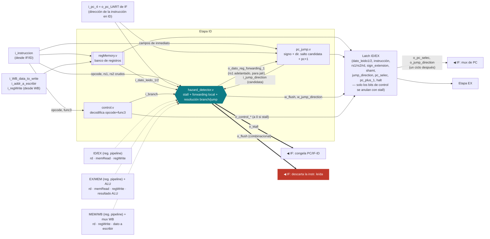

# ID → Instruction Decode

## Resumen

Módulo que:
- Decodifica la instrucción, 
- lee el banco de registros, 
- genera las señales de control para las etapas siguientes, 
- calcula la extensión de signo/dirección de salto, y 
- **resuelve branches y jumps acá mismo** (no en EX/MEM como en el diseño "de libro"). 
- También decide stalls por hazards de datos (load-use y dependencias de branch/`jalr`).

## Archivos

- `ID/instruccionDecode.v` → orquesta todo lo de abajo y contiene el latch ID/EX.
- `ID/regMemory.v` → banco de registros.
- `ID/control.v` → unidad de control principal (decodifica opcode RV32I).
- `ID/pc_jump.v` → extensión de signo por tipo de instrucción + cálculo de dirección de salto candidata + `pc+1`.
- `ID/hazard_detector.v` → detección de stalls, forwarding local para branches y resolución de flush/salto.

## Diagrama

> *`IDEX_REG`, `EXMEM_REG` y `MEMWB_REG` (líneas punteadas) representan que `hazard_detector` mira registros de pipeline que están físicamente más adelante en el flujo.*

> *`o_stall`/`o_flush` (líneas gruesas) vuelven hacia atrás, a IF, al revés del sentido normal del pipeline.*

## Señales clave

| Señal | Sentido | Qué es |
|---|---|---|
| `i_instruccion[6:0]` | — | opcode RV32I |
| `i_instruccion[19:15]` / `[24:20]` / `[11:7]` | — | rs1 / rs2 / rd |
| `i_pc_4` | entrada | dirección (índice de palabra) de la instrucción en ID. Es `o_pc_UART` de IF, que en el top se llama `w_pc_jump` (no confundir con el `w_pc_jump` interno de `IFetch.v`, que es la salida del mux) |
| `o_control_EX_ALUOp`, `o_control_EX_ALUSrc`, `o_control_M_branch`, `o_control_M_memRead/Write`, `o_control_WB_memtoReg/regWrite` | salida | señales de control que viajan a EX/MEM/WB |
| `o_sign_extension`, `o_shamt` | salida | inmediato ya extendido en signo, y `instr[24:20]` en 5 bits, listos para la ALU |
| `o_pc_plus_1` | salida | `i_pc_4 + 1`; EX lo convierte en bytes como valor de *link* de JAL/JALR |
| `o_flush` | salida | combinacional: hay un salto tomado en ID y no hay stall (`w_flush && !o_stall`); *IF descarta la instrucción que estaba leyendo* |
| `o_pc_selec`, `o_jump_direction` | salida | **registradas** en ID/EX: hacen que IF pise el PC con el destino un ciclo después |
| `o_stall` | salida | congela PC/IF-ID cuando hay un hazard de datos que forwarding no resuelve a tiempo |
| `o_halt` | salida | el HALT sigue su camino por el latch ID/EX hasta WB |

## ➯ Módulo `control.v`: decodificación del opcode

Switch sobre `opcode` (7 bits), con los opcodes RV32I reales:
- `0110011` (R-type), 
- `0010011` (I-type/ADDI),
- `1100011` (branches),
- `1101111`/`1100111` (JAL/JALR),
- `0100011` (stores),
- `0000011` (loads),
- `0110111` (LUI). 

> Cualquier opcode no reconocido cae al `default` *(todas las señales de control en 0 → efectivamente un NOP, y así se trata el HALT).*

> `func3` solo se usa en dos casos: en I-type para distinguir los shifts inmediatos (`001`/`101`, que usan `shamt`), y en branches para separar `beq` (`000`) del resto.

> Los distintos tamaños de load/store se resuelven más adelante (EX y MEM leen `func3` directamente de la instrucción).

| Instrucción | ALUOp | ALUSrc | branch | memRead | memWrite | memToReg | regWrite |
|---|---|---|---|---|---|---|---|
| R-type | `10` | `00` | `00` | 0 | 0 | 0 | 1 |
| I-type aritmético | `11` | `01` (`10` en `slli`/`srli`/`srai`) | `00` | 0 | 0 | 0 | 1 |
| Loads | `00` | `01` | `00` | 1 | 0 | 1 | 1 |
| Stores | `00` | `01` | `00` | 0 | 1 | 0 | 0 |
| Branches | `01` | `00` | `01` (`beq`) / `11` (cualquier otro `func3`, tratado como `bne`) | 0 | 0 | 0 | 0 |
| JAL / JALR | `01` | `11` | `10` | 0 | 0 | 0 | 1 |
| LUI | `01` | `01` | `00` | 0 | 0 | 0 | 1 |

🪧 `ALUSrc` elige el operando B de la ALU: 
- `00` registro (con forwarding),
- `01` inmediato,
- `10` `shamt`,
- `11` dirección de retorno (`pc+1` en bytes, para JAL/JALR). 

🪧 `branches`: 
- `01` salta si igual,
- `11` salta si distinto,
- `10` salto incondicional.

## ➯ `pc_jump.v`: extensión de signo por formato

Cada tipo de instrucción arma el inmediato con sus propios bits (formato RISC-V real: I/S/B/J/U), y en los casos que aplica calcula además la dirección de salto candidata, ya convertida a índice de palabra:

- **Branches (`Tipo_B`) y JAL →** `pc + offset/4`.
- **JALR (`Tipo_Jalr`) →** `(rs1 + imm)/4`, tomando `rs1` como dirección en bytes. Usa el `rs1` ya adelantado que sale de `hazard_detector.v`, no el crudo del banco de registros. 
*(Las instrucciones `Tipo_L` y `Tipo_I` comparten esa rama de cálculo, pero su resultado solo se usa si la instrucción es JALR.)*

Además entrega `o_pc_plus_1 = pc + 1`.

## ➯ `hazard_detector.v`: dónde se resuelven los saltos

- **Stall** (`o_stall`), en dos situaciones:
  - **Load-use:** la instrucción en ID usa un registro que la instrucción en ID/EX va a cargar desde memoria (`memRead` pendiente).
  - **Branch o `jalr` con dependencia:** el branch necesita comparar (o el `jalr` necesita `rs1`) y el valor todavía no está disponible:
    - o lo produce un load que está en EX/MEM, 
    - o lo produce la instrucción que está en ID/EX (todavía en la ALU). 
  *Se espera un ciclo y el forwarding local resuelve el resto.*

- **Forwarding local** (`mux_data1`/`mux_data2`): antes de comparar, cada operando del branch puede venir de: 
   - del resultado de la ALU (instrucción en EX/MEM) 
   - o del dato de WB (instrucción en MEM/WB).

- **Flush/branch** (`o_flush`, `o_jump_direction`): 
  - `branch=01` salta si los operandos son iguales, `11` si son distintos, `10` siempre.
  - Branch tomado → `o_flush = 1` y `o_jump_direction` = destino candidato; *si no se toma, `o_jump_direction` queda en el PC actual.*

- **Sin salto durante un stall:** `instruccionDecode.v` anula el flush mientras hay stall (`o_flush = w_flush && !o_stall`, y lo mismo para `o_pc_selec`). Así un branch que espera un dato no salta comparando operandos viejos; *la decisión se toma recién cuando el dato está disponible.*

## ➯ `regMemory.v`: banco de registros

- 32 registros de 32 bits.

  - **Lectura combinacional** (dos puertos, `rs1` y `rs2`)
  - **Escritura síncrona** en el flanco de clock, y nunca se escribe `x0`.

- **Bypass de escritura a lectura:** si una instrucción en ID lee el registro que otra está escribiendo desde WB en ese mismo ciclo, recibe directamente el dato nuevo (`i_dato_a_escribir`), no el que todavía está guardado.

- Tiene un tercer puerto de lectura, registrado (`i_addr_tx` → `o_data_send_tx`), que usa el *Debug Manager* para volcar los registros.

- Los valores iniciales se cargan con `$readmemb` desde `memory/memReg.mem`: `x1=0x90`, `x2=0xa01`, `x3=0xc000`, `x4=0xb0001`, `x5=0xe00000`, `x6=0xf000001`, el resto en 0.

- El **reset no lo restaura**: esos valores solo se cargan al programar la FPGA, así que después de un reset la corrida siguiente arranca con los registros que dejó la anterior.

## ✨ Particularidades

- El forwarding para uso en la ALU vive en EX, no acá → el de `hazard_detector.v` es solo para poder comparar los operandos del branch a tiempo, dentro de la misma etapa.

- Resolver el salto en ID (en vez de EX/MEM) reduce la penalidad de branch a una burbuja, pero exige que este módulo tenga visibilidad de EX, MEM y WB simultáneamente.

- En el latch ID/EX solo los bits de **control** se ponen a 0 cuando hay stall (así la instrucción atrasada pasa como burbuja).
