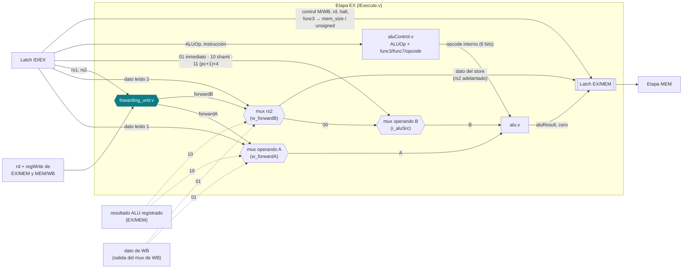

# EX → Execute

## Resumen

Módulo que:
- Ejecuta la operación aritmético-lógica. 
- Resuelve los hazards de datos que no se resolvieron en ID mediante forwarding desde EX/MEM y MEM/WB. 
- También contiene el latch EX/MEM.

## Archivos

- `EX/IExecute.v` → orquesta todo lo de abajo, selecciona los operandos de la ALU y contiene el latch EX/MEM.
- `EX/fowarding_unit.v` → decide de dónde toma cada operando la ALU.
- `EX/aluControl.v` → traduce `ALUOp` + `func3`/`func7`/`opcode` al opcode interno de la ALU.
- `EX/alu.v` → la ALU.

## Diagrama

> *Los números sobre las flechas son el valor del selector que elige esa entrada.* 

> *Las líneas punteadas son el forwarding: datos que vuelven desde etapas más adelantadas.*

## Señales clave

| Señal | Sentido | Qué es |
|---|---|---|
| `i_datoLeido1`, `i_datoLeido2` | entrada | operandos leídos del banco de registros en ID |
| `i_datoExtSigno`, `i_shamt`, `i_pcPlus1` | entrada | alternativas para el operando B: inmediato, `shamt` o dirección de retorno (`pc+1`, que EX convierte a bytes) |
| `i_aluSrc` | entrada | selecciona el operando B: `00` registro (con forwarding), `01` inmediato, `10` `shamt`, `11` `{pc+1, 2'b00}` |
| `w_forwardA`, `w_forwardB` (internas, de `fowarding_unit`) | — | `00`=banco de registros, `10`=EX/MEM, `01`=MEM/WB |
| `o_aluResult`, `o_ceroSignal` | salida | resultado y flag de cero, van al latch EX/MEM (`o_ceroSignal` solo se usa para debug) |
| `o_datoLeido2` | salida | `rs2` ya adelantado: es el dato que escribe un store |
| `o_mem_size`, `o_meme_unsigned` | salida | `instr[13:12]` e `instr[14]` (`func3`), para loads/stores en MEM |

## ➯ `fowarding_unit.v`: unidad de cortocircuito

Compara `rs1`/`rs2` de la instrucción en EX contra el registro destino de las instrucciones que están una etapa adelante (EX/MEM) y dos etapas adelante (MEM/WB). 

Prioridad: si ambas condiciones matchean, gana la más cercana (EX/MEM). 

No reenvía si el destino es `x0` (registro 0).

🪧 **De dónde sale cada dato:** 
- lo que viene "de EX/MEM" es el resultado de la ALU registrado (`w_aluResult_EX`),
- lo que viene "de MEM/WB" es la salida del mux de WB (`w_WB_writeData_forwarding`, ya con el dato de memoria si era un load).

## ➯ `aluControl.v`: de control de 2 bits a opcode de ALU

`ALUOp` (2 bits, viene de `control.v` en ID) más `func3`/`func7`/`opcode` de la instrucción arman una tabla completa de casos → es la tabla de verdad clásica del diseño de Patterson & Hennessy, adaptada a los campos de RISC-V. 

Cubre R-type (`ALUOp=10`), I-type (`ALUOp=11`), loads/stores (`ALUOp=00`) y LUI/JAL/JALR (`ALUOp=01`). 

Los branches también llegan con `ALUOp=01`, pero devuelven un opcode inválido: no usan la ALU, se resuelven en ID.

## ➯ `alu.v`: operaciones soportadas

- **AND, OR, ADD, XOR, SUB, SLL, SRL, SRA, SLTU, SLT,** y dos variantes de suma para direcciones de memoria (`LSs`/`LUs`, con y sin signo). 
- Un opcode más (`LUI_AND_J`) pasa directo el operando B: sirve para LUI (B = inmediato) y para el *link* de JAL/JALR (B = `pc+1` en bytes). 
- El opcode interno es de 6 bits, definido al principio del archivo → ***no es el opcode RISC-V**, es una codificación interna propia de este diseño.*
- Los shifts (SLL, SRL, SRA) usan solo `i_datoB[4:0]` como cantidad de desplazamiento, como pide RV32I. En los shifts inmediatos esto no cambia nada, porque `shamt` ya llega de 5 bits.

## ✨ Particularidades

- Dos "capas" de forwarding en el pipeline: la de `hazard_detector.v` (en ID, solo para comparar en branches) y esta (en EX, para la ALU). No comparten lógica.
- El opcode que ve `alu.v` es una codificación interna de 6 bits que arma `aluControl.v` → no confundir con `funct3`/`funct7` de RISC-V ni con el opcode de la instrucción.