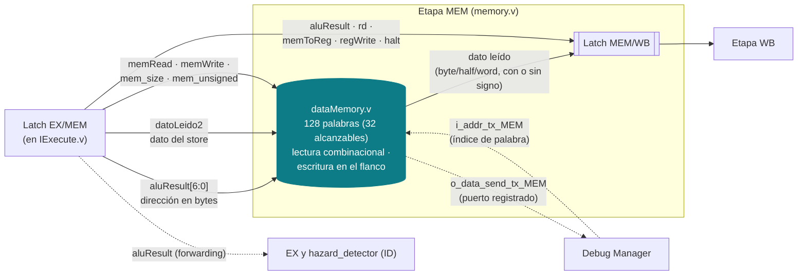

# MEM → Memory Access

## Resumen

Módulo que:
- tiene acceso a memoria de datos:
  - lee (loads) o 
  - escribe (stores) *según las señales de control que vienen de EX*

## Archivos

- `MEM/memory.v` → instancia la memoria de datos y contiene el latch MEM/WB. (El latch EX/MEM está en `EX/IExecute.v`.)
- `MEM/dataMemory.v` → la memoria de datos en sí.

## Diagrama

> *El puerto del Debug Manager es independiente del acceso del programa. Usa un índice de palabra directo de 7 bits, por eso puede leer las 128 palabras.*

## Señales clave

| Señal | Sentido | Qué es |
|---|---|---|
| `i_memRead`, `i_memWrite` | entrada | habilitan lectura/escritura |
| `i_aluResult` | entrada | dirección de memoria (viene de la ALU, registrada en EX/MEM) |
| `i_datoLeido2` | entrada | dato a escribir en un store (el `rs2` ya adelantado) |
| `i_mem_size`, `i_mem_unsigned` | entrada | tamaño del acceso (byte/half/word) y signo → para LB/LH/LBU/LHU |
| `o_readData`, `o_aluResult`, `o_rd` | salida | van al latch MEM/WB |

## ✨ Particularidades

- El tamaño y signo del acceso (`i_mem_size`/`i_mem_unsigned`) se extraen directamente de la instrucción en EX (`i_instruccion[13:12]` y `i_instruccion[14]`, campos del `func3` de loads/stores en RISC-V), no de una señal de control dedicada. Se guardan en el latch EX/MEM y llegan acá.

- La memoria es **little-endian** y se accede por byte, 
  - media palabra o palabra: `sb`/`sh` modifican solo la parte correspondiente de la palabra, 
  - y `lb`/`lh` extienden signo (o completan con ceros en `lbu`/`lhu`).

- **La lectura es combinacional** (desde el latch EX/MEM) y el resultado se registra en MEM/WB; **la escritura** ocurre en el flanco de clock.

- **Solo hay 32 palabras accesibles.** `dataMemory` declara 128 palabras (`RAM_DEPTH = 128`), pero `memory.v` le pasa los 7 bits bajos de la dirección en bytes (`i_aluResult[6:0]`) y la memoria indexa la palabra con `[6:2]`: **son 128 bytes = 32 palabras**. 
  - Una dirección ≥ 128 se enrosca módulo 128 (por ejemplo, un store al byte 128 pisa la palabra 0).
  - Las palabras 32 a 127 existen pero ningún programa puede alcanzarlas.
  - El volcado por UART, en cambio, sí las envía (recorre las 128 palabras con un índice de palabra directo), así que en el volcado aparecen 96 palabras que el programa nunca puede modificar.

- Los valores iniciales se cargan con `$readmemb` desde `memory/memData.mem` (ruta relativa en `FILE_DATA`. El **reset no los restaura**: después de un reset **la memoria conserva lo que dejó la corrida anterior**.

- No hay hazard estructural que resolver acá → MEM no necesita saber nada de otras etapas más que lo que le llega por el pipeline.
