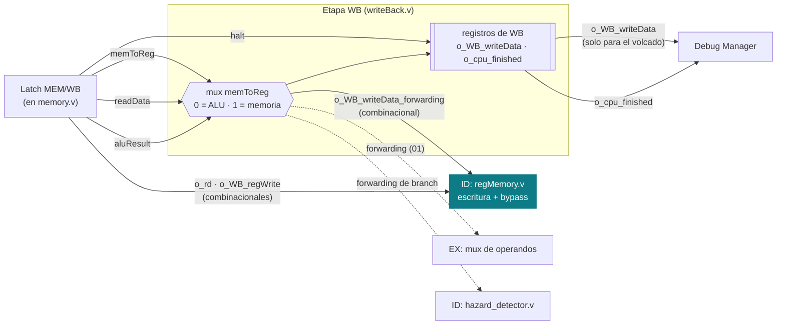

# WB → Write Back

## Resumen

Última etapa: elige entre el resultado de la ALU y el dato leído de memoria, y ese valor es el que se escribe de vuelta en el banco de registros. 

También es donde se detecta que el programa terminó.

## Archivos

- `WB/writeBack.v`

## Diagrama

## Señales clave

| Señal | Sentido | Qué es |
|---|---|---|
| `i_memToReg` | entrada | selector del mux: `0`=ALU, `1`=memoria |
| `i_AluResult`, `i_datoLeido_MEM` | entrada | las dos fuentes del mux (vienen del latch MEM/WB) |
| `i_regWrite`, `i_rd` | entrada | si hay que escribir y en qué registro |
| `o_WB_writeData_forwarding` | salida | salida **combinacional** del mux. Es el dato que se escribe en el banco de registros y el que se reenvía a EX y al `hazard_detector` |
| `o_rd`, `o_WB_regWrite` | salida | combinacionales (pasan `i_rd`/`i_regWrite`, forzados a 0 durante el reset). Junto con el dato anterior forman la escritura en `ID/regMemory.v` |
| `o_WB_writeData` | salida | el mismo dato pero **registrado**; solo se usa para el volcado por UART del Debug Manager |
| `o_cpu_finished` | salida | registrada; se activa cuando `i_halt` llega hasta acá (instrucción HALT completó el pipeline) |

## ✨ Particularidades

- El write-back físico (la escritura en el banco de registros) no pasa acá: esta etapa solo prepara el dato, el registro destino y el habilitador, que vuelven como entrada a `regMemory.v` en la etapa ID.

- **La escritura es síncrona, pero ID ve el dato en el mismo ciclo.** El dato se guarda en el flanco que cierra el ciclo en que la instrucción está en WB. Si en ese mismo ciclo hay una instrucción en ID que lee ese registro (dependencia a distancia 3), `regMemory.v` le entrega directamente el dato que está llegando desde WB (bypass de escritura a lectura), sin esperar a que se guarde.

- El banco de registros no obedece a `i_step`: escribe en cada flanco mientras `o_WB_regWrite` esté activo. En modo paso a paso escribe el mismo valor muchas veces entre un paso y otro, sin efecto sobre el resultado.

- `o_cpu_finished` es la señal que finalmente le informa al Debug Manager que el programa terminó de ejecutar.
