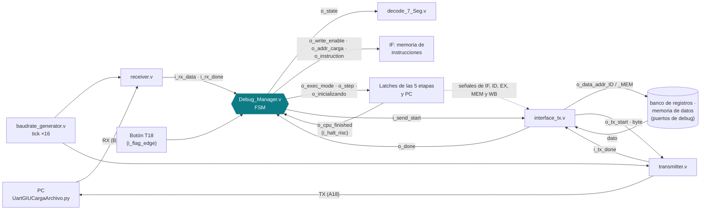
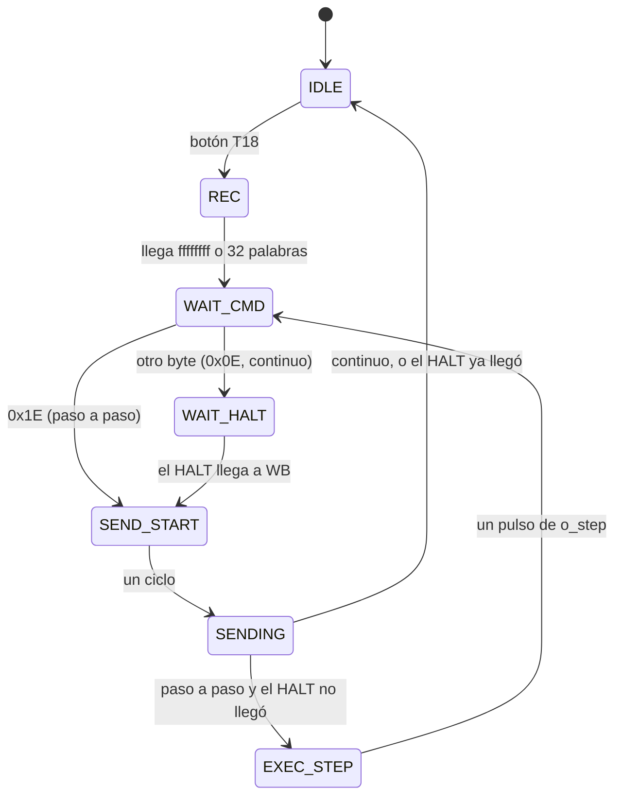

# Infraestructura de carga y debug por UART

## Resumen

El programa no se precarga en un `.mem`/`.hex` de Vivado: **se manda por UART en tiempo real**, y el mismo canal se usa para debuggear el pipeline paso a paso (ver registros, resultado de ALU, memoria de datos, bits de control de cada etapa).

## Archivos

- `Uart/` → enlace físico: `transmitter.v`, `receiver.v`, `baudrate_generator.v`, `UART_Top.v`. 115200 baudios, 8 bits de datos, con el clock de 50 MHz del sistema (parámetros de `UART_Top.v`).
- `debug_manager/Debug_Manager.v` → FSM *(Finite State Machine)* central.
- `debug_manager/interface_tx.v` → arma y transmite el volcado de datos del procesador.
- `decode_7_Seg.v` → muestra `o_state` (estado de la FSM) en el display de 7 segmentos, para debuggear sin terminal UART.
- `constraints/mips_constraints.xdc` → asignación de pines (RX en B18, TX en A18, botón de inicio en T18).

## Diagrama

### Conexiones

### FSM del Debug Manager

> *En paso a paso, cada `0x1E` primero manda el volcado del estado actual y después avanza un ciclo.*

## Qué hace el Debug Manager

1. Recibe la secuencia de instrucciones por UART y las escribe en la memoria de instrucciones de IF (`o_write_enable`, `o_addr_carga`, `o_instruction`).

2. Controla el modo de ejecución de **todo** el pipeline: 
    - `o_exec_mode` (continuo vs. paso a paso) y 
    - `o_step` (pulso para avanzar un ciclo en modo paso a paso). 
    - `o_inicializando` mantiene detenido al PC mientras se carga el programa.

3. Multiplexa hacia UART (TX) el estado interno de cada etapa.

## La FSM *(Finite State Machine)* (`Debug_Manager.v`)

| Estado | Código | Display | Qué hace |
|---|---|---|---|
| `IDLE` | `000` | 0 | **Reposo**. Deja listo todo para una nueva carga (dirección 0, modo continuo, PC detenido). El botón de inicio (`i_flag_edge`, pin T18) lo pasa a `REC` |
| `REC` | `010` | 2 | Recibe cada instrucción como 4 bytes y la escribe en la memoria de instrucciones. Sale al recibir el HALT (`ffffffff`) o al completar 32 instrucciones |
| `WAIT_CMD` | `001` | 1 | Espera el byte de modo: `0x1E` = paso a paso, cualquier otro (`0x0E` en la práctica) = continuo |
| `WAIT_HALT` | `011` | 3 | **Modo continuo:** el pipeline corre libre hasta que el HALT llega a WB (`i_halt_risc`) |
| `SEND_START` | `110` | apagado | **Un ciclo:** dispara el volcado |
| `SENDING` | `101` | 5 | Espera a que `interface_tx` termine de enviar |
| `EXEC_STEP` | `100` | 4 | **Modo paso a paso:** emite el pulso `o_step` (un ciclo de pipeline) |

➯ Recorridos:

- **Carga:** `IDLE` → (botón) → `REC` → `WAIT_CMD`.
- **Paso a paso (`0x1E`):** `WAIT_CMD` → `SEND_START` → `SENDING` (volcado del estado actual) → `EXEC_STEP` (un ciclo) → `WAIT_CMD`, y así hasta que el HALT llega a WB, momento en que vuelve a `IDLE`. Por eso hay que reenviar `1E` en cada paso.
- **Continuo (`0x0E`):** `WAIT_CMD` → `WAIT_HALT` → `SEND_START` → `SENDING` → `IDLE`.

> Reprogramar no requiere resintetizar: al volver a `IDLE` y apretar el botón, la nueva carga sobrescribe la memoria de instrucciones desde la dirección 0.

## Pasos:

En el repo, en `Ensamblador/ensamblador_riscv.py` se genera la secuencia de bytes y el script `UartPython/UartGIUCargaArchivo.py` la envía.

1. Apretar el botón de inicio de la placa (T18) para pasar a `REC`.
2. Cada palabra de 32 bits se manda como 4 bytes, **del menos al más significativo**: `0045a480` → `80 a4 45 00`.
3. El stream de instrucciones termina con `ffffffff` (HALT). La FSM acepta hasta 32 palabras, pero la palabra 31 se lee siempre como HALT (ver `02-IF.md`), así que entran 31 instrucciones útiles.
4. Se manda el byte de modo de ejecución: `0x1E` paso a paso, `0x0E` continuo. En modo paso a paso, hay que reenviarlo después de cada paso.
5. Al terminar, el estado final de los registros y de la memoria de datos debe coincidir sea cual sea el modo de ejecución usado.

## Qué se envía (`interface_tx.v`)

Cada volcado son palabras de 32 bits, mandadas como 4 bytes (LSB primero), en este orden:

| Bloque | Palabras | Contenido |
|---|---|---|
| IF | 2 | PC de la instrucción en ID (`o_pc_UART`), instrucción |
| ID | 5 | `{rs1, rd, bits de control ID, flush, rs2}` empaquetados, dato leído 1, dato leído 2, inmediato extendido, dirección de salto |
| EX | 3 | resultado ALU, dato de store, `{rd, bits de control EX, cero}` empaquetados |
| MEM | 3 | resultado ALU, dato leído de memoria, `{rd, bits de control MEM}` empaquetados |
| WB | 2 | dato a escribir, `{rd, regWrite}` empaquetados |
| Memoria de datos | 128 | todas las palabras del arreglo (`MEM_DATA_COUNT`). Solo las 32 primeras son alcanzables por un programa (ver `05-MEM.md`) |
| Registros | 32 | el banco completo (`MEM_REG_COUNT`) |

> En total son 175 palabras (700 bytes): a 115200 baudios, cada volcado tarda unos 61 ms.

## ✨ Particularidad

Los latches de pipeline de las 5 etapas comparten la misma condición de habilitación (`i_exec_mode == 1'b0 || (i_exec_mode && i_step)`) → es lo que le permite al Debug Manager pausar el pipeline completo instrucción por instrucción sin lógica adicional en cada etapa. 

La excepción es el banco de registros, que escribe en cada flanco (ver la documentación `06-WB.md`).
