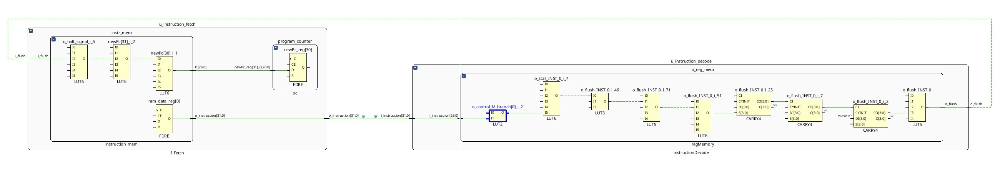
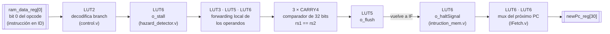

# ⏰ Clock — camino crítico, skew y frecuencia máxima

## Resumen

La consigna pide identificar el camino crítico del sistema, determinar si genera *skew* y, si corresponde, encontrar y aplicar la frecuencia óptima de funcionamiento, medida con Vivado.

Resultado del análisis a 50 MHz (diseño implementado):

- **Hay skew, pero es despreciable:** −0,050 ns, el 0,25 % del período.
- **El camino crítico** va de la instrucción que está en ID hasta el registro del próximo PC: la decisión de un branch (comparación de 32 bits y `flush`) vuelve a IF en el mismo ciclo.
- **Frecuencia máxima estimada: ~78 MHz.** El diseño actual a 50 MHz tiene 7,188 ns de margen.

## Configuración del clock

- **Un solo dominio de clock.** El clock de la placa (100 MHz, pin W5) entra al IP `clk_wiz_0` *(MMCM - Mixed-Mode Clock Manager)*, que genera `w_clk_50MHz`. Todos los módulos del procesador, la UART, el Debug Manager y el ILA usan ese clock.
- **Distribución por red global.** La salida del MMCM pasa por un BUFG *(Global Clock Buffer)*, diseñada para que el clock llegue casi al mismo tiempo a todos los flip-flops.
- **El clock no se interviene.** Todos los registros disparan en `posedge`. 
- **El modo paso a paso no apaga el clock.** Se usan señales de *enable* (`i_exec_mode`, `i_step`) que deciden si cada registro carga o mantiene su valor.


## Cómo se obtuvieron los valores 
> *(desde la GUI de Vivado)*

1. *Flow Navigator* → **Implementation → Open Implemented Design**. Se mide **sobre el diseño implementado**, porque recién ahí están los retardos reales de ruteo.
2. **Reports → Timing → Report Timing Summary**, con *Max paths per clock* = 10 (ordenados por slack).
3. En la pestaña *Timing*: **Intra-Clock Paths → (clock de 50 MHz) → Setup**. La tabla lista los 10 peores caminos.
4. **Doble click** sobre el camino → pestaña **Summary**, donde aparecen todos los valores que estan a continuación.

## Valores medidos

Resumen general:

| Valor | Resultado | Qué significa |
|---|---|---|
| **WNS** (*Worst Negative Slack*) | 7,202 ns | Margen de **setup** del peor camino del diseño. Positivo →  todos los caminos llegan a tiempo y sobran 7,202 ns respecto del período de 20 ns. |
| **WHS** (*Worst Hold Slack*) | 0,025 ns | Margen de **hold** del peor camino. Positivo →  ningún dato cambia demasiado pronto después del flanco. |

---

| Campo | Valor | Qué significa |
|---|---|---|
| **Source** | `u_instruction_fetch/instr_mem/ram_data_reg[0]/C` | Flip-flop donde arranca el camino: el registro de salida de la memoria de instrucciones, que contiene la instrucción que está en ID. El bit 0 forma parte del **opcode**. |
| **Destination** | `u_instruction_fetch/program_counter/newPc_reg[30]/D` | Flip-flop donde termina: bit 30 del registro del próximo PC. |
| **Data Path Delay** | 12,719 ns | Tiempo que tarda el dato en recorrer toda la lógica y el ruteo entre los dos flip-flops. |
| **Logic Levels** | 12 (CARRY4=3, LUT2=1, LUT3=1, LUT5=2, LUT6=5) | Cantidad de celdas lógicas en serie que atraviesa el camino. Ver el desglose en *Camino crítico*. |
| **Clock Path Skew** | −0,050 ns | Diferencia entre lo que tarda el clock en llegar al flip-flop destino y al de origen. Negativo → llega antes al destino, lo que le resta margen al setup. |
| **Clock Uncertainty** | 0,108 ns | Margen que agrega Vivado por el *jitter* del MMCM y del sistema. No es skew: es la variación del propio flanco. |

## Cálculos

### ➯ Composición del slack

```
Slack = Período − Data Path Delay − |Skew| − Uncertainty − T_setup

7,202 ns ≈ 20 ns − 12,719 ns − 0,050 ns − 0,108 ns − (−0,079 ns)
```

Los −0,079 ns son el tiempo de setup del flip-flop destino. Se obtuvo de la misma tabla de detalles de tiempo en Vivado.

### ➯ Frecuencia máxima

El período mínimo es el período actual menos el margen sobrante del peor camino:

```
T_min = T_actual − WNS = 20 ns − 7,188 ns = 12,812 ns

f_max = 1 / T_min = 1 / 12,812 ns ≈ 78 MHz
```

**🪧 Es una estimación.** Al cambiar la frecuencia, Vivado rehace el *place & route* y los retardos de ruteo cambian, así que hay que reimplementar y volver a verificar WNS ≥ 0 y WHS ≥ 0.

## Skew

**Sí, hay skew** → el clock no llega exactamente al mismo tiempo a todos los flip-flops. 

En el camino crítico es de **−0,050 ns**, el 0,25 % del período de 20 ns, así que es despreciable y **no limita la frecuencia**. Lo que la limita es el retardo del camino de datos (12,719 ns).

Es un valor bajo por dos decisiones del diseño:

1. Hay un único clock, distribuido por la red global (BUFG) desde el MMCM.
2. El clock nunca pasa por lógica. El paso a paso y el control de ejecución se implementan con *enables*.

## Camino crítico: los 12 niveles de lógica

Todo este recorrido es combinacional y ocurre en **un solo ciclo** → desde que la instrucción sale del registro de la memoria de instrucciones (flanco *n*) hasta que el próximo PC se captura en `newPc_reg` (flanco *n+1*). Las celdas son las que muestra el Schematic de Vivado (F4 sobre el path).





| # | Celda | Dónde | Qué hace |
|---|---|---|---|
| 1 | LUT2 | `ID/control.v` | Decodifica el opcode y arma la señal `branch`. El origen es el bit 0 del opcode. |
| 2 | LUT6 | `ID/hazard_detector.v` | Calcula `o_stall`, que depende del tipo de instrucción y de las dependencias con ID/EX y EX/MEM. |
| 3–5 | LUT3, LUT5, LUT6 | `ID/hazard_detector.v` | Forwarding local: elige de dónde sale cada operando del branch (banco de registros, resultado de la ALU o dato de WB). |
| 6–8 | 3 × CARRY4 | `ID/hazard_detector.v` | Comparador de igualdad de 32 bits (`beq`/`bne`), armado sobre la cadena de carry. |
| 9 | LUT5 | `ID/instruccionDecode.v` | `o_flush = w_flush && !o_stall`: el salto se toma y no hay stall. |
| 10 | LUT6 | `IF/intruction_mem.v` | `o_haltSignal = (HALT o dirección 31) && !i_flush`: un salto tomado anula la detección de HALT. |
| 11–12 | LUT6, LUT6 | `IF/IFetch.v` | Mux del próximo PC: `halt ? w_pc_jump : w_pc_incremented`. |

**12 niveles = 3 CARRY4 + 9 LUTs** (LUT2 ×1, LUT3 ×1, LUT5 ×2, LUT6 ×5).

En el Schematic varias de estas celdas aparecen dentro de `u_reg_mem`, porque Vivado optimiza y reubica la lógica entre módulos. Por los nombres (`o_stall_INST…`, `o_flush_INST…`) se reconoce de qué señal del RTL vienen.

El bit de destino (`newPc_reg[30]`) no tiene nada especial: la selección del mux llega igual a los 32 bits del PC, y Vivado reporta el que quedó con menos margen por ruteo.

**Qué hace largo al camino:** el `flush` de un branch se decide en ID (decodificación, forwarding y comparación de 32 bits) y en el mismo ciclo vuelve a IF para anular la detección de HALT y elegir el próximo PC. El destino del salto (`o_jump_direction`) y la selección del mux de salto (`o_pc_selec`) **no** están en este camino, porque salen registrados del latch ID/EX.

Este camino es consecuencia de resolver los saltos en ID. La decisión, con sus ventajas y costos, está en `01-arquitectura-general.md` (*Dónde se resuelven los saltos*).
